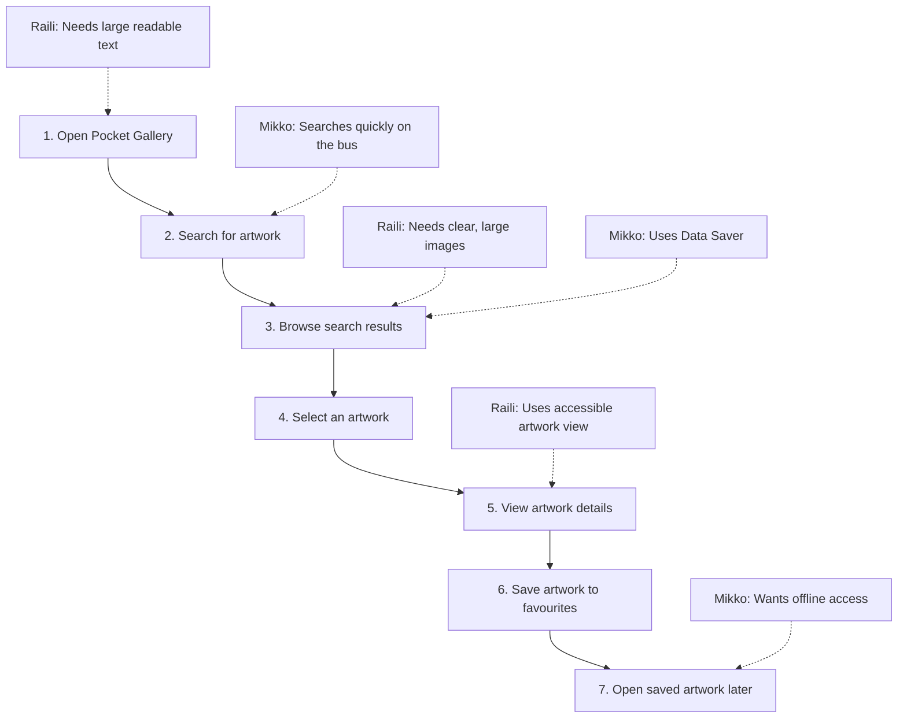

# Pocket Gallery – User Research

## 1. User Personas

### Persona 1: Raili – The Art Lover

- **Age:** 72
- **Location:** Kuopio, Finland
- **Occupation:** Retired teacher
- **Interests:** Art, paintings and culture
- **Device:** Android smartphone

**Background:**

Raili loves visiting museums and looking at paintings. She enjoys browsing artwork on her phone at home, especially in the evening. However, she has reduced central vision and sometimes uses TalkBack.

**Goals:**
- Browse artwork comfortably.
- View large and clear artwork images.
- Read artwork information easily.
- Save favourite artworks.

**Frustrations:**
- Small text and buttons.
- Poor colour contrast.
- Buttons that only have icons without labels.
- Complicated menus.

**Design needs:**
- Large readable text.
- High contrast mode.
- Clear buttons with text labels.
- Accessible image descriptions.
- A comfortable full-screen artwork view.

### Persona 2: Mikko – The Busy Student

- **Age:** 19
- **Occupation:** First-year university student
- **Location:** Siilinjärvi–Kuopio, Finland
- **Interests:** Art, photography and technology
- **Device:** Older Android smartphone

**Background:**

Mikko is a university student who enjoys discovering artwork and photography. He often uses his phone while travelling by bus between Siilinjärvi and Kuopio. His internet connection can be unreliable, and he has a limited mobile data plan.

**Goals:**
- Search for artwork quickly.
- Save favourite artworks.
- Access saved artwork offline.
- Continue browsing from his previous search.

**Frustrations:**
- Slow image loading.
- Endless loading indicators.
- High mobile data usage.
- Losing his search position after restarting the app.

**Design needs:**
- Data Saver mode.
- Tap-to-load artwork images.
- Offline access to favourites.
- Remember the last search.
- Clear loading and error messages.

## 2. User Scenarios

### Scenario 1: Raili browses artwork at home

Raili is sitting at home in the evening. She opens Pocket Gallery because she wants to discover paintings from the Cleveland Museum of Art.

She searches for "flowers". She views the search results and selects a painting that interests her. She opens the artwork in a large view so she can see the details clearly. She reads the artwork information and saves it to her favourites.

**Expected result:** Raili can browse artwork comfortably using readable text, clear images and accessible controls.

### Scenario 2: Mikko browses artwork on the bus

Mikko is travelling by bus from Siilinjärvi to Kuopio. He opens Pocket Gallery and searches for "photography".

Because his mobile data is limited, he enables Data Saver mode. The app displays search results without automatically downloading all artwork images. He taps an image when he wants to view it.

**Expected result:** Mikko can browse artwork while controlling mobile data usage.

### Scenario 3: Mikko opens his saved artwork offline

Mikko previously searched for "modern art" and saved some favourite artworks. Later, he travels by bus where the internet connection is unavailable.

He opens Pocket Gallery and visits his favourites. He selects a saved artwork and reads its stored information without needing an internet connection.

**Expected result:** Mikko can access his saved artworks and continue using the app when offline.

## 3. User Journey Map

The following journey map shows how Raili and Mikko use Pocket Gallery to discover and save artwork.



### Differences Between the Two Users

| Journey step | Raili | Mikko |
|---|---|---|
| Open app | Needs clear navigation | Wants quick access |
| Search | Needs readable search field | Wants fast searching |
| Browse | Needs large, clear images | Wants to save mobile data |
| View details | Needs large text and accessibility | Wants concise information |
| Save artwork | Wants an easy-to-use button | Wants favourites available offline |
| Return later | Wants to find saved works easily | Wants offline access and search continuity |

### Main Design Priorities

1. Accessibility for users with reduced vision.
2. Efficient browsing for users with limited mobile data.
3. Offline access to saved artwork.
4. Clear feedback during loading, searching and saving.
5. Simple navigation and readable information.
```

## 4. User Testing Tasks

### Task 1: Search and view artwork (Raili)

**User:** Raili, 72

**Task:** Find a painting by searching for "flowers". Open one artwork and read its details.

**It works if:**
- Raili can find the search field easily.
- Search results display artwork titles and images.
- She can open an artwork.
- The artwork view has readable text and a large image.
- Screen reader labels are available for important controls.

### Task 2: Browse with Data Saver (Mikko)

**User:** Mikko, 19

**Task:** Enable Data Saver, search for "photography" and browse the results without automatically loading every image.

**It works if:**
- Mikko can enable Data Saver in settings.
- Search results load without automatically downloading all thumbnails.
- He can tap an image to load it.
- The app gives clear feedback.

### Task 3: Save and open artwork offline (Mikko)

**User:** Mikko, 19

**Task:** Search for "modern art", save one artwork, close the app and reopen it without an internet connection.

**It works if:**
- The artwork is saved successfully.
- The favourite remains after restarting the app.
- The saved artwork can be opened offline.
- Its stored title and artwork information are visible.
